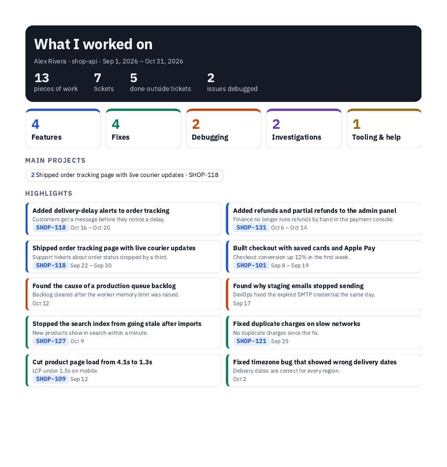

# claude-plugins

[](LICENSE)
[](https://claude.com/claude-code)


Claude Code plugins by Burhan Shaheen. Add the marketplace once, then install the plugins you need.

**Contents:** [Quick start](#quick-start) · [grove](#grove-git-worktrees-made-easy) · [wlog](#wlog-your-work-log-written-for-you) · [Repository layout](#repository-layout) · [Issues](#issues) · [License](#license)

## Plugins

| Plugin | In one line | Install |
|---|---|---|
| [**grove**](plugins/grove) | Git worktrees made easy: switch, diff, review and commit from a band above the prompt, one chat per worktree, and guards that keep agents in their own worktree. | `/plugin install grove@burhanrepos` |
| [**wlog**](plugins/worklog) | Never forget what you worked on: a work log built from your Claude Code chats and your own commits, with a 1-page PDF for reviews. | `/plugin install wlog@burhanrepos` |

## Quick start

In Claude Code, send each line as its own message:

```
/plugin marketplace add burhanrepos/claude-plugins
/plugin install grove@burhanrepos
/plugin install wlog@burhanrepos
/reload-plugins
```

Install only the plugins you want. To get updates later, run `/plugin marketplace update burhanrepos`.

---

## grove: git worktrees made easy

Work on several tickets at once without stashing, re-installing or losing track of which chat belongs to which branch.

- **One folder per branch**, named after the ticket. `grove ls` lists them with lines changed and commits to pull or push.
- **No re-install.** Worktrees with the same lockfile share one `node_modules`.
- **One chat per worktree.** `grove open` resumes that worktree's chat in a new tab. `grove sessions` merges worktree chats back into the main checkout.
- **Review in Claude Code.** Buttons for diff, review (who changed each line, and when), compare (did the port happen), commit, push and shell.
- **Guards.** Agents edit only their own worktree. Nothing is committed or pushed without you.

Also works with Codex, Gemini CLI and Cursor through `rules/AGENTS.md`. Needs git 2.36+ and Node 18+. Runs on Linux, macOS and Windows.

After installing, run `grove setup` once in each repo. Full guide: [plugins/grove](plugins/grove).

## wlog: your work log, written for you

When a review, standup or probation check-in comes around, get a 1-page summary instead of a blank page.



- **Backfills your history** from past Claude Code chats and your own commits.
- **Logs as you go.** Claude adds an entry after each task; a hook records each commit.
- **Five categories:** features, fixes, debugging for other teams, investigations, tooling and help.
- **Outputs:** 1-page PDF, an interactive page with search and filters, and an optional private online page to share.
- **Stays local.** Everything is kept in `~/.claude/worklog/`. Nothing is sent anywhere unless you publish the page.

Needs Python 3.8+ (standard library only) and git 2.31+. Chrome, Chromium or Edge for the PDF.

After installing, run `/wlog:log setup` in a repo. Full guide: [plugins/worklog](plugins/worklog).

---

## Repository layout

```
.claude-plugin/marketplace.json   the marketplace: lists every plugin
plugins/grove/                    grove plugin and CLI
plugins/worklog/                  wlog plugin
```

Each plugin folder is a complete Claude Code plugin with its own README, `.claude-plugin/plugin.json` and license.

## Issues

Found a bug or have an idea? [Open an issue](https://github.com/burhanrepos/claude-plugins/issues) and name the plugin in the title.

## License

[MIT](LICENSE). Each plugin is MIT licensed as well.
